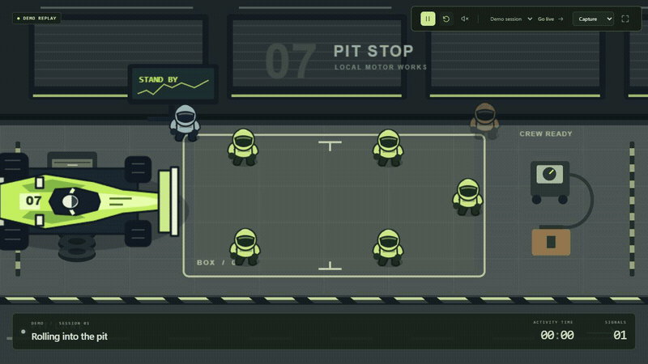

# Pit Stop

A tiny animated pit crew for your coding agent. Original local artwork,
reversible hooks, no Pit Stop accounts, cloud service or API keys.



Windows 11 is the first supported build target. Claude Code 2.1.287 and
Codex CLI 0.159.3 have passed real local event-delivery checks. Cursor's
tool-hook adapter remains **unverified** with a real session.
Codex CLI supports **turn completion only**.
Successful tool execution never implies that a test suite passed.

## Run

Build the installer using the instructions below, then run
`target/release/bundle/nsis/Pit Stop_0.1.0_x64-setup.exe`.
The unsigned installer may trigger Windows reputation warnings. Microsoft
WebView2 must already be installed; this installer never downloads it.
No Node.js or Rust is needed on the installed user's machine.

Open Pit Stop and try the deterministic demo. Choose compact, expanded or
capture layout, a colorway, reduced motion, frame limit and optional sound.
Sound is muted initially. Capture hides setup clutter for OBS or the system
recorder; Pit Stop does not record or upload anything.

Click **Connect coding agents**, select an adapter and inspect the exact
configuration change. Approve the checkbox to apply it. Pit Stop backs up
existing configuration, preserves third-party hooks, tests local transport
and explains restart requirements. This synthetic test does not certify
provider compatibility. Restart your coding agent and switch to live mode.
Remote/cloud agents cannot reach the local desktop and are unsupported.

Disconnect each integration inside Pit Stop before uninstalling the app.
Disconnect removes only owned hook entries. Backups and preferences remain
under `%LOCALAPPDATA%/Pit Stop`; the helper lives in its `bin` directory.
If manual cleanup is necessary, remove only commands pointing to that helper
from `~/.claude/settings.json` or `~/.cursor/hooks.json`, or Pit Stop's own
`notify` entry in `~/.codex/config.toml` (`CODEX_HOME` is respected).
Keep other hooks and settings. Existing Codex notifiers are never replaced.

## Build on Windows

Install Node.js 22 LTS, pnpm 10.18.3, Rust stable, Visual Studio C++ build
tools and WebView2. All are development prerequisites, not runtime services.

```powershell
pnpm install --frozen-lockfile
node scripts/package-helper.mjs
cargo test --workspace --locked
pnpm test
pnpm test:visual:install
pnpm test:visual
pnpm build
pnpm --filter desktop tauri dev
```

For an installer:

```powershell
node scripts/package-helper.mjs
pnpm --filter desktop tauri build
```

`pnpm dev` runs a browser-only demo; native integration controls require
Tauri. `pnpm build` only builds the frontend. The native release contains
the hook helper and local scene assets. macOS/Linux are not validated release
targets. No automatic update checks run at application startup.

Pit Stop's code and assets use local communication only. Windows WebView2
is a Microsoft runtime with its own diagnostic behavior. Background HTTPS
connections were observed from its browser process on the development host;
Pit Stop cannot promise zero remote connections for that system component.
See [security boundaries](SECURITY.md) before relying on strict offline isolation.

## Verification and privacy

See [release validation](docs/VALIDATION.md), [architecture](ARCHITECTURE.md),
[security boundaries](SECURITY.md) and [contributing](CONTRIBUTING.md).
Events cross authenticated loopback after being reduced to fixed enums,
opaque identifiers and timing. Prompts, code, paths, command text, shell
output and transcripts never reach the renderer. History is memory-only.
Closing Pit Stop leaves hooks fail-open; Cursor pre-tool hooks always emit
an allow response. No security policy settings are changed.

An empty live view usually means the agent needs restarting, hooks are not
connected, or the session runs remotely. Diagnostics show listener and
configuration status without revealing bearer tokens or raw events. A
malformed configuration is left untouched. Reopen setup after another
application changes configuration; stale previews cannot be applied.

Original code, graphics and synthesized sounds are MIT licensed. Bundled
dependencies retain their own licenses; see [asset licensing](assets/LICENSES.md)
and the bundled third-party notices. Run `node scripts/check-licenses.mjs`
and `node scripts/generate-notices.mjs` before redistributing a changed build.
